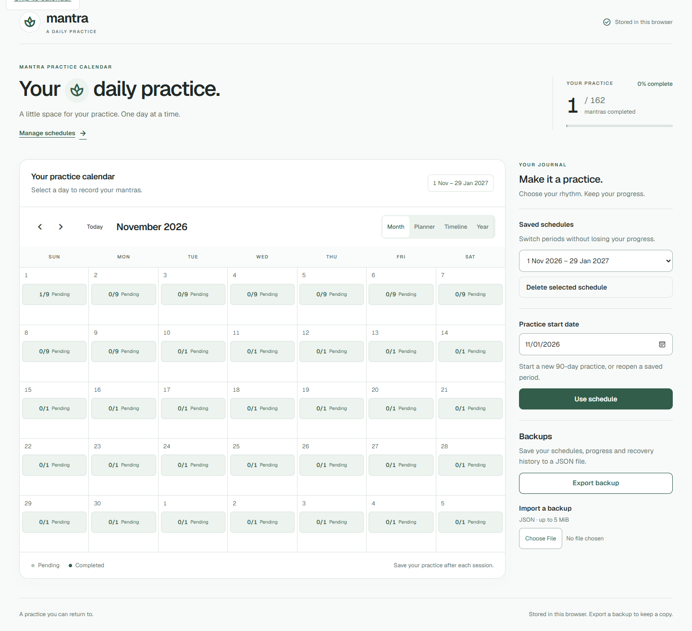

# Mantra Practice Calendar — နေ့စဉ် ဂုဏ်တော်ရွတ်ဖတ်မှု မှတ်တမ်း

နေ့စဉ် ဂုဏ်တော်ရွတ်ဖတ်မှုကို ပြက္ခဒိန်ပေါ်မှာ မှတ်သားပြီး မိမိလေ့ကျင့်မှုကို ပြန်ကြည့်နိုင်ဖို့ ရေးထားတဲ့ Web App ဖြစ်ပါတယ်။ စတင်မယ့်ရက်ကို ကိုယ်တိုင်ရွေးချယ်ပြီး ရက် ၉၀ အတွက် သတ်မှတ်ထားတဲ့ ဂုဏ်တော်အစီအစဉ်အတိုင်း အသုံးပြုနိုင်ပါတယ်။

C# နဲ့ Blazor WebAssembly ကို လေ့လာသူတွေအတွက် ပြက္ခဒိန် UI၊ နေ့စဉ်မှတ်တမ်း၊ IndexedDB နဲ့ browser ထဲမှာ data သိမ်းဆည်းခြင်း၊ JSON backup နဲ့ data ပြန်ယူခြင်းတို့ကို လေ့လာနိုင်တဲ့ project တစ်ခုလည်း ဖြစ်ပါတယ်။

## Summary

> စတင်မယ့်ရက်ကို ရွေးပါ။ ပြက္ခဒိန်ထဲက နေ့တစ်နေ့ကို နှိပ်ပြီး ရွတ်ဖတ်ပြီးတဲ့ ဂုဏ်တော်တွေကို အမှန်ခြစ်ပါ။ **Save practice** နှိပ်လိုက်ရင် မှတ်တမ်းကို ဒီ browser ထဲမှာ သိမ်းထားပေးပါမယ်။

1. **Practice start date** မှာ စတင်မယ့်ရက်ကို ရွေးပြီး **Use schedule** နှိပ်ပါ။
2. ပြက္ခဒိန်ထဲက ရက်တစ်ရက်ကို နှိပ်ပြီး မိမိရွတ်ဖတ်ပြီးတဲ့ ဂုဏ်တော်တွေကို မှတ်သားပါ။
3. **Save practice** နှိပ်ပြီး သိမ်းပါ။ **Cancel** နှိပ်ရင် အခုဖွင့်ထားတဲ့ ပြင်ဆင်မှုတွေကို မသိမ်းပါ။
4. **Saved schedules** ကနေ အရင်သိမ်းထားတဲ့ အစီအစဉ်တွေကို ပြန်ဖွင့်နိုင်ပါတယ်။
5. **Export backup** နဲ့ JSON ဖိုင်ထုတ်သိမ်းထားပြီး နောက်မှ **Import a backup** နဲ့ ပြန်ယူနိုင်ပါတယ်။

## Preview



Desktop မှာ ပြက္ခဒိန်နဲ့ မှတ်တမ်းစီမံခန့်ခွဲတဲ့ controls တွေကို ဘေးချင်းယှဉ် ပြထားပါတယ်။ Mobile မှာ ပြက္ခဒိန်ကို အရင်ပြပြီး controls တွေကို အောက်မှာ ပြထားပါတယ်။ **Manage schedules** ကနေ controls ဆီ တိုက်ရိုက်သွားနိုင်ပါတယ်။

## Features

- စတင်ရက်ကို ရွေးချယ်နိုင်တဲ့ ရက် ၉၀ ဂုဏ်တော်အစီအစဉ်။
- နေ့စဉ် ရွတ်ဖတ်ပြီးမှုနဲ့ အစီအစဉ်တစ်ခုလုံးရဲ့ တိုးတက်မှုကို ကြည့်နိုင်ခြင်း။
- Month, Planner, Timeline နဲ့ Year ပြက္ခဒိန် view များ။
- အစီအစဉ်တစ်ခုချင်းစီရဲ့ မှတ်တမ်းကို သီးခြားသိမ်းထားပြီး ပြန်ရွေးနိုင်ခြင်း။
- IndexedDB ထဲမှာ သိမ်းထားတဲ့အတွက် page reload လုပ်ပြီးလည်း မှတ်တမ်းကျန်ရှိခြင်း။
- အစီအစဉ်၊ ရွတ်ဖတ်မှုမှတ်တမ်းနဲ့ Recently deleted recovery copies တွေကို JSON backup ထုတ်သိမ်းခြင်း၊ ပြန်ယူခြင်း။
- ဖျက်ထားတဲ့ အစီအစဉ်တွေကို **Recently deleted schedules** ကနေ ပြန်ယူနိုင်ခြင်း။
- Recovery copy တစ်ခုချင်းစီ အပြီးဖျက်ခြင်းနဲ့ Recently deleted အားလုံးရှင်းခြင်းမတိုင်မီ confirmation ပြခြင်း။
- Backup ထုတ်ခဲ့တဲ့အချိန်နဲ့ နောက်ပိုင်း data ပြောင်းလဲမှု ရှိမရှိကို permanent-delete dialog ထဲမှာ ပြခြင်း။
- Mobile layout၊ keyboard navigation နဲ့ reduced-motion setting ကို ပံ့ပိုးထားခြင်း။

The supplied sequence covers **90 days and 162 individual mantra entries**. Its original template runs from **9 July to 6 October 2025**; choosing another start date shifts the same sequence to that period.

## Tech Stack

| Part | Technology |
| --- | --- |
| Language | C# |
| Application | .NET 8, Blazor WebAssembly |
| UI components | Radzen.Blazor |
| Browser storage | Native IndexedDB |
| Backup files | JSON |
| Styling | CSS, self-hosted Geist with Burmese font fallback |
| Checks | .NET console assertions and Playwright browser scripts |

No backend server or account is required for saving practice data. The development server serves the application; journal data is stored in the browser.

## Getting Started

### Requirements

- .NET 8 SDK, or a compatible newer SDK.
- A modern browser with IndexedDB enabled.
- Git to clone the repository.

### Run locally

Clone this repository, open its root directory, then run:

```sh
dotnet restore BlazorWasm.MantraCalendar.sln
dotnet run --project BlazorWasm.MantraCalendarApp --launch-profile http
```

Open [http://localhost:5094](http://localhost:5094).

A fresh journal starts with the device's current date. To use a different period, choose a start date and select **Use schedule**. Existing periods retain their progress when you switch.

### Build

```sh
dotnet build BlazorWasm.MantraCalendar.sln
```

## Backup & Restore

### Export a backup

**Export backup** downloads a file named **mantra-backup.json** containing:

- All saved schedules and their practice progress.
- The currently selected schedule.
- All recently deleted recovery copies.

Save the downloaded file somewhere you can find again. Backup files contain readable practice history; keep them somewhere appropriate for that information.

### Restore a backup

1. Under **Import a backup**, choose a JSON file of **5 MiB or less**.
2. Review the schedule, replacement and recovery-copy counts.
3. Select **Restore backup**, or **Cancel** to leave everything unchanged.

For matching start dates, imported progress replaces the stored progress. Schedules absent from the file remain saved. Recovery copies merge by unique ID; existing copies are kept, and importing the same file again does not duplicate them.

New exports use backup **version 2**. Older **version 1** files remain importable and do not remove existing recovery history. Invalid files and failed restore transactions leave the journal unchanged.

## Delete & Recover

| Action | Result |
| --- | --- |
| **Delete selected schedule** | Moves that schedule and its progress into Recently deleted after confirmation. |
| **Restore selected schedule** | Returns the selected recovery copy to saved schedules and opens it. |
| **Permanently delete selected copy** | Removes only the selected recovery copy after confirmation. |
| **Empty recently deleted** | Removes the recovery copies listed when confirmation opened; saved schedules remain. |

Recovery copies remain available after reload and have no automatic expiry. Repeated deletions create separate copies, even for the same start date. Restoring a copy does not overwrite an existing saved schedule with the same start date.

Both permanent-delete dialogs let you export a backup before confirming. They show the last export time and warn if schedules, progress or recovery history differ from that backup. Status refreshes while the dialog is open and when you return to the tab. Permanent deletion is disabled while a status check or export is running; **Keep**, **Escape** and **Close** remain available.

If a status check fails, a coverage warning is shown before the delete button becomes available again. Exporting is optional: a warning does not prevent you from confirming permanent deletion.

**A download-start time does not prove the file was saved.** Once recovery history is permanently removed, restoring it requires a backup that contains those copies. Status checks do not lock other tabs, so data can change after a check finishes.

## Data & Privacy

Practice data stays in the current browser profile and site address. There are no accounts or cloud synchronization. Using another browser, device or site address creates a separate journal.

- Clearing site data or removing the browser profile can erase schedules and recovery history.
- Export a backup before clearing data or moving to another device.
- Simultaneous edits to the same schedule in different tabs use the last committed full-schedule save.
- Normal storage uses IndexedDB; there is no localStorage fallback.
- On first initialization only, progress from the older localStorage version can be imported into its original July 2025 schedule. That legacy value is not changed or deleted.

## Project Structure

```text
BlazorWasm.MantraCalendarApp/
├── Layout/                     # Application shell
├── Pages/                      # Calendar, practice editor and delete dialogs
├── Services/                   # Mantra sequence and schedule models
└── wwwroot/
    ├── css/                    # Shared styling
    ├── fonts/                  # Self-hosted Geist and its license
    └── js/practice-db.js        # IndexedDB, backups and recovery
tests/                          # Schedule, storage and browser checks
specs/                          # Feature specifications and validation records
.specify/                       # Spec Kit configuration and templates
.agents/skills/                 # Codex Spec Kit workflows
DESIGN.md                       # UI design guidelines
```

## Testing

Run the package-free schedule checks:

```sh
dotnet run --project tests/MantraCalendar.Checks
```

For browser checks, install Node.js and Microsoft Edge, keep the app running at **http://localhost:5094**, and make **playwright-core** available to Node. For example, from the repository root:

```sh
npm install --no-save --package-lock=false playwright-core
node tests/ResponsiveUi.checks.cjs
node tests/DialogBackup.checks.cjs
node tests/CompleteDeleteFlow.checks.cjs
```

These scripts use fresh browser contexts and synthetic schedules. They cover responsive layouts, recording practice, backup warnings, export/import, final delete confirmations and recovery after reload. They do not use your existing browser journal. Screenshots are written to the Git-ignored **outputs/** directory.

Additional IndexedDB assertions are in **tests/IndexedDb.checks.js**. Run its **checkIndexedDb()** function from a fresh isolated browser context on the app's origin; it refuses to run if a journal already exists.

Feature details and validation records are in [specs/](specs/). The interface rules are in [DESIGN.md](DESIGN.md).

## Contributing

Bug reports, documentation improvements and pull requests are welcome. Include reproduction steps for bugs, and run the checks relevant to your change. Changes to persistence, backup or deletion behavior should include checks that existing progress remains recoverable.

The bundled Geist font includes its [SIL Open Font License](BlazorWasm.MantraCalendarApp/wwwroot/fonts/OFL.txt).
